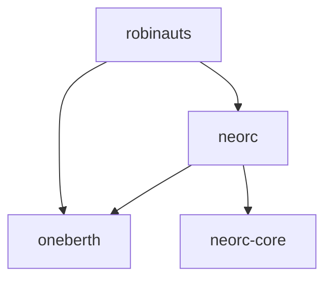

# Core

## What oneberth is

oneberth is the shared base of neorc and Robinauts.
It holds sign-in, sessions, tokens, roles, the web application, the application shell, the
admin scripts and the desktop launcher.

neorc and Robinauts each have a copy of the same sign-in code today.
Robinauts wrote its copy from neorc's design, and the two copies now differ
([review.md](review.md), "What the code holds today").
oneberth holds the one copy both applications use.

oneberth is a library. A backend is a composition that oneberth builds from the
components of one or more applications ([composition.md](composition.md)).
"One place" means one code base and one store per deployment.

## Goals

1. **One pattern, four shapes.** The same components run in a cluster, as desktop processes
   and in desktop containers. A shape changes who starts a component and where it listens.
2. **Identity in one place.** Sign-in, sessions, tokens and roles live in oneberth.
   neorc and Robinauts keep the permissions each route needs and the checks on ownership.
3. **A credential on every request.** Every shape has a signed-in person or a token behind
   each request. The desktop signs its one person in locally.
4. **Dependencies point one way.** oneberth knows neither application. neorc knows oneberth.
   Robinauts knows both.
5. **One owner of the web framework.** oneberth alone imports FastAPI. An application
   describes its routes in oneberth's contract.
6. **The rules of the two projects hold.** oneberth is Apache-2.0, passes Robinauts' licence
   gate, sends nothing to a third party, and tests its logic in memory first.

## What each repository ships

| repository | ships |
|---|---|
| oneberth | `oneberth`, a Python library; `@oneberth/ui`, a node package of interface components |
| neorc | `neorc-core`; `neorc`, the standalone application; the neorc interface, as a wheel of built files and as a node package of components |
| Robinauts | the cloud application; the desktop application |

The node packages hold browser code. An application's build compiles them into its bundle.
Production runs no Node process.

The package names are proposals. Nothing is published under them yet.

## Dependencies

| package | depends on |
|---|---|
| `neorc-core` | none of the three; its one runtime dependency is a YAML parser |
| `oneberth` | none of the three |
| `neorc` | `neorc-core`, `oneberth` |
| Robinauts | `oneberth`, `neorc` |

FastAPI comes to both applications through `oneberth[web]`.

Robinauts depends on `neorc`, the application.
Robinauts composes neorc's manager into its backend, and the manager's routes and
stores live in `neorc`. `neorc-core` alone would make Robinauts write them again.

`neorc-core` stays free of oneberth. It names its permissions and roles as plain data, and
the `neorc` application gives that data to oneberth ([identity.md](identity.md), "Roles").

The node packages follow the same direction. The neorc interface package names
`@oneberth/ui` and React as peer dependencies, and the host application brings one copy of each.

## Components

| component | what it does |
|---|---|
| backend | a composition: serves the interface, the oneberth routes and the API of its components |
| worker | runs work for a backend: a Robinauts turn worker, or a neorc worker on a queue |
| manager | neorc's backend: holds the flows and their runs |
| scheduler | moves neorc's runs forward; a deployment runs one |
| store | where oneberth keeps users, credentials and grants |
| launcher | starts and stops the desktop's components, and opens the window |
| window | Chrome or Chromium in application mode, showing the interface |

## The shapes in one table

| | cluster | desktop, processes | desktop, Docker |
|---|---|---|---|
| who starts the components | the platform | the launcher | the launcher |
| database | PostgreSQL | SQLite | SQLite |
| the backend runs as | containers | one process | one container |
| neorc's manager | composed into the backend, or a deployment of its own | composed into the backend | composed into the backend |
| sign-in | identity providers | local | local |
| the interface opens in | any browser | the window | the window |
| workers run as | containers | processes | containers and processes |

[shapes.md](shapes.md) describes each shape.

## What moves to oneberth

| today | in neorc | in Robinauts | in oneberth |
|---|---|---|---|
| identities, the allow list, sessions, pending sign-ins | `neorc_core/_access.py` | `web/sign_in.py` | the identity core |
| the OpenID Connect client | `neorc/auth/_oidc.py` | `web/oidc.py` | the provider adapter |
| the sign-in configuration | `neorc/auth/_config.py` | `web/sign_in.py` | the configuration reader |
| cookies and the checks on a write | `manager/_sign_in.py`, `manager/_access.py` | `web/cookies.py`, `web/app.py` | the web adapter |
| the `/auth/*` routes | `manager/_auth_routes.py` | `web/app.py` | the web adapter |
| the credential stores | `ports/_credentials.py`, memory, PostgreSQL | `Credentials`, in process, PostgreSQL | one port; memory, PostgreSQL and SQLite stores |
| roles and permissions | `Role`, `Permission`, `PERMISSIONS` | none | the role engine; each application declares its own table |
| users | none | `users` | the store |
| device pairing | none | `web/pairing.py` | the identity core |
| token commands | `neorc tokens`, `neorc sessions` | `robinauts devices` | one set of commands |
| the session in the browser, the sign-in page | `session.ts`, `SignIn.tsx` | `session/`, `devices/` | `@oneberth/ui` |
| the security headers on the interface | `manager/_ui.py` | `web/headers.py` | the web adapter |
| the web application and its server | `manager/_app.py`, `manager/_service.py` | `web/app.py`, `cli/main.py` | the composition |
| the declaration of a route | `manager/_routes.py`, on FastAPI | `web/app.py`, `web/worker_api.py`, on FastAPI | each application, in oneberth's contract |

## Documents

[README.md](README.md) lists them.
