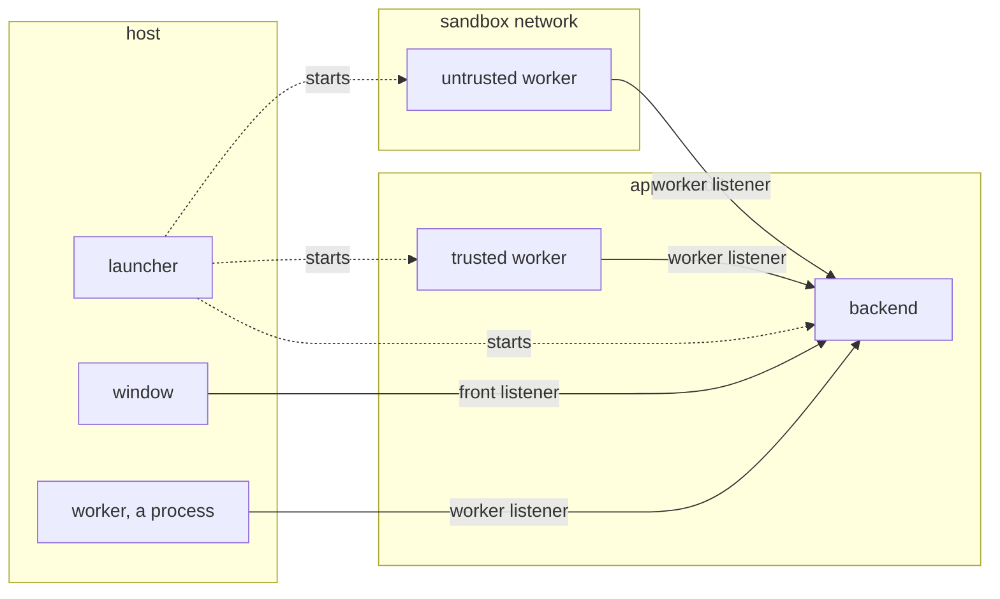

# Deployment shapes

The same components run in every shape ([core.md](core.md), "Components").
A shape decides who starts a component, where it listens and where the data lives.

## Supervisors

- A component is started by a supervisor. The supervisor is the platform in a cluster and
  the launcher everywhere else.
- A backend starts nothing outside its own process.
- Robinauts' server starts its own workers today. That job moves to the launcher.

## Listeners

- A backend has a **front listener**. It serves the interface, the API and `/auth`.
- A backend may open a **worker listener**. It serves the routes a worker role may call.
- The routes of the worker listener are derived. Every route declares its permission, and a
  route is served there when a worker role holds that permission.
- A network that holds untrusted workers reaches the worker listener alone.
- The composition builds both listeners ([composition.md](composition.md), "Composing").

## Trust

| level | who | holds | reaches |
|---|---|---|---|
| trusted | the backend, the manager, the scheduler, the launcher | the database, the operator's secrets | everything |
| trusted worker | a worker that runs the project's own code | a token, and the keys its engines need | the worker listener, the model providers, the tool servers |
| untrusted worker | a worker that runs code nobody reviewed, such as code an agent writes | a token | the worker listener |

An untrusted worker follows these rules:

- It runs in a container or in a VM. A process on the host reaches every loopback port.
- Its token is bound to one queue or to one worker name.
- It reads only the tasks it holds. Robinauts' worker routes are wider today
  ([review.md](review.md), F6).
- It holds none of the operator's secrets: no model key, no database URL, no tool server secret.
- It keeps its engines' state in storage of its own.

A token limits every worker, trusted or not. The network is the second limit.

## Starting a worker

- The supervisor gives a worker a token and the address of the worker listener.
- A worker reads its token from standard input, or from a file that a variable names.
- A worker says `ready` on standard output once it serves. The launcher waits for that line.
- The launcher stops a worker with SIGTERM.

## The cluster

- The platform runs each part as a workload of its own: the backend, with several
  replicas; one scheduler; each worker; and neorc's manager, when it is deployed apart.
- The database is PostgreSQL. One database holds three schemas: `robinauts`, `neorc`, `oneberth`.
- People sign in through identity providers. TLS ends in front of the backends.
- Each application has a public URL of its own. Robinauts' backend composes neorc's manager,
  or forwards `/neorc/` to a manager deployed apart ([neorc-in-robinauts.md](neorc-in-robinauts.md)).
- The operator creates the service tokens with the command line. The platform keeps them as
  secrets and gives each to its workload as a file.
- The worker listener is a service of its own, kept off the public entry. A network policy
  lets the worker workloads reach that service alone.
- One image per application serves the cluster and the desktop's Docker shape.
- A single server stays a supported shape. `robinauts start` uses the launcher there for its
  own processes, behind a reverse proxy, as [deployment.md](https://github.com/the-guish/robinauts/blob/main/docs/deployment.md) describes today.

## The desktop, as processes

- The launcher starts the backend as one process, each worker as a process, and the window.
- The database is SQLite, in the data directory.
- neorc's manager and scheduler run inside the backend's process, as parts of the composition.
- The person is signed in locally ([identity.md](identity.md), "Locally").
- The front listener is on a loopback address.
- Every worker is a trusted worker here. An untrusted worker needs the Docker shape or a VM.
- This shape needs no Docker.

## The desktop, with Docker

The configuration names at least one worker that runs in a container. The whole
application then runs in this shape.

- The launcher creates the networks, then starts the backend's container, the workers'
  containers, the workers that stay processes, and the window.
- The backend runs in a container, from the image the cluster uses.
- The data directory is the same host directory as in the processes shape, mounted into the
  backend's container. A person who adds a first Docker worker keeps their data.
- The front listener is published on a loopback address of the host. The window opens there.
- The worker listener is published on a loopback address too, for the workers that stay processes.
- The launcher talks to Docker. The backend's container holds no Docker socket.
- The launcher refuses to start while Docker is not running. It names the workers that need it.

There are two networks:

| network | holds | way out |
|---|---|---|
| `app` | the backend and the trusted workers' containers | yes |
| `sandbox` | the backend and the untrusted workers' containers | none |

The `sandbox` network is an internal Docker network. Its containers reach the worker listener alone.

One cost is known. A service on the host's loopback address, such as a local tool server or
a local model, is outside the container. The backend and its workers reach it through the
host's gateway name.

## A worker in a VM

- A VM worker is an untrusted worker. It follows the same rules as a container on `sandbox`.
- The supervisor gives the VM a token and the address of the worker listener.
- The path between the VM and the listener is open ([review.md](review.md), Q4).

## The launcher

- The launcher is a part of the `oneberth` Python library. An application's command calls it.
- The application gives the launcher a list of components. Each has a name, a command or an
  image, a trust level and the configuration it needs.
- The launcher runs on Linux and macOS, like Robinauts today.
- One launcher runs per data directory. A second start brings the first one's window forward.

The launcher starts an application in this order:

1. It makes the launch secret.
2. It starts the backend and writes the launch secret on its standard input.
3. It waits for the backend to say `ready`.
4. It asks the backend for one service token per worker.
5. It starts each worker and writes the worker's token on its standard input.
6. It asks the backend for a ticket and opens the window with it.

The launcher stops the workers first and the backend last.
The launch secret and the tokens of a start end at the stop.

## The window

- The window is Chrome or Chromium started with `--app=<url>`. It has no address bar and no tabs.
- The window uses a profile directory of its own, inside the data directory. The launcher can
  then watch the window's process, and the session cookie stays out of the person's everyday profile.
- The launcher looks for Chrome, Chromium, Edge and Brave. It opens the default browser at the
  same URL when it finds none.
- The front listener keeps the same port across starts. A browser remembers the theme, the
  open application and the folded panels per origin.
- A link to another site opens in a plain window of the same profile. This is a known limit.

## Storage

| | the cluster | the desktop |
|---|---|---|
| Robinauts' records | schema `robinauts` | `robinauts.db` |
| neorc's records | schema `neorc` | `neorc.db` |
| oneberth's store | schema `oneberth` | `oneberth.db` |
| an engine's state | the engine's tables | a folder per worker |

- The backend's process alone opens the SQLite files.
- neorc tells waiting workers about a new task through PostgreSQL's notifications today.
  SQLite has none across processes. The manager on SQLite runs inside the backend and
  notifies in memory.
- The memory stores stay, for tests and for `neorc run`.
- Three SQLite stores are new code: oneberth's, neorc's and Robinauts' controller's.
  Each passes the contract suite of its port.

## Details likely to change

- The names of the networks and of the database files.
- The list of browsers the launcher looks for.
- Where the data directory is on each operating system.

## Open

[review.md](review.md) holds the open points of this document: the model keys of an
untrusted worker (Q3), the path to a VM (Q4), what closing the window does (Q5), and SQLite
on a directory shared with a container (F4).
