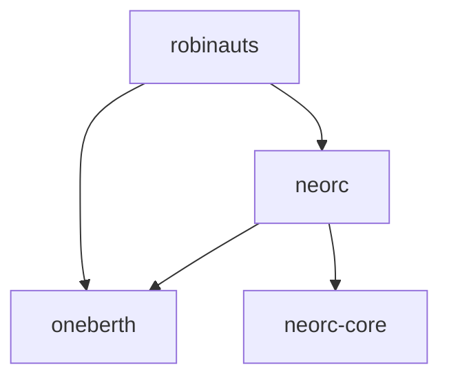

# Core

## What oneberth is

oneberth is the shared base of neorc and Robinauts.
It holds sign-in, sessions, tokens, roles, the web application, the application shell, the
admin scripts and the desktop launcher.

oneberth is a library. A backend is a composition that oneberth builds from the
components of one or more applications ([composition.md](composition.md)).
"One place" means one code base and one store per deployment.

## Goals

1. **One pattern, four shapes.** The same components run in a cluster, as desktop processes
   and in desktop containers. A shape changes who starts a component and where it listens.
2. **Identity in one place.** Sign-in, sessions, tokens and roles live in oneberth.
   neorc and Robinauts hold the permissions each route needs and the checks on ownership.
3. **A credential on every request.** Every shape has a signed-in person or a token behind
   each request. The desktop signs its one person in locally.
4. **Dependencies point one way.** oneberth knows neither application. neorc knows oneberth.
   Robinauts knows both.
5. **Written once.** oneberth holds what both applications need: the composing of the web
   application, its server and the checks on a request. An application writes its own
   routes on FastAPI.
6. **The rules of the two projects hold.** oneberth is Apache-2.0, passes Robinauts' licence
   gate, sends nothing to a third party, and tests its logic in memory first.

## What each repository ships

| repository | ships |
|---|---|
| oneberth | `oneberth`, a Python library; `@oneberth/ui`, a node package of interface components |
| neorc | `neorc-core`; `neorc`, the standalone application; the neorc interface, as a wheel of built files and as a node package of components |
| Robinauts | the cloud application; the desktop application |

The node packages hold browser code. An application's build compiles them into its bundle.
Production runs no Node process.

## Dependencies

| package | depends on |
|---|---|
| `neorc-core` | none of the three; its one runtime dependency is a YAML parser |
| `oneberth` | none of the three |
| `neorc` | `neorc-core`, `oneberth` |
| Robinauts | `oneberth`, `neorc` |

FastAPI comes to both applications through `oneberth[web]`.

Robinauts depends on `neorc`, the application.
The desktop composes neorc's manager into Robinauts' backend, and the manager's routes and
stores live in `neorc`.

`neorc-core` imports nothing of oneberth. It names its permissions and roles as plain data, and
the `neorc` application gives that data to oneberth ([identity.md](identity.md), "Roles").

The node packages follow the same direction. The neorc interface package names
`@oneberth/ui` and React as peer dependencies, and the host application brings one copy of each.

## Who holds what

| responsibility | held by |
|---|---|
| identities, users, the allow list, sessions, tokens, device pairing | oneberth |
| the OpenID Connect client and the sign-in configuration | oneberth |
| the stores of users and credentials: memory, PostgreSQL, SQLite | oneberth |
| the check of a permission | oneberth |
| the table of an application's permissions and roles | each application |
| the checks on ownership, such as whose conversation this is | each application |
| the web application, its server, the `/auth` routes, the checks on a request, the security headers | oneberth |
| the routes of an application, written on FastAPI | each application |
| the admin scripts | oneberth |
| the launcher and the window | oneberth |
| the rail, the session in the browser, the sign-in page, the account pages | `@oneberth/ui` |
| an application's own pages and panels | each application |

## Components

| component | what it does |
|---|---|
| backend | a composition: serves the interface, the oneberth routes and the API of its components |
| worker | runs work for a backend: a Robinauts turn worker, or a neorc worker on a queue |
| manager | neorc's backend: holds the flows and their runs |
| scheduler | moves neorc's runs forward; a deployment runs one |
| store | where oneberth keeps users, credentials and grants |
| launcher | starts and stops the desktop's components, and opens the window |
| window | Chrome or Chromium in application mode, showing the interface |

## The shapes in one table

| | cluster | desktop, processes | desktop, Docker |
|---|---|---|---|
| who starts the components | the platform | the launcher | the launcher |
| database | PostgreSQL | SQLite | SQLite |
| the backend runs as | containers | one process | one container |
| neorc's manager | a deployment of its own; Robinauts forwards to it | composed into Robinauts' backend | composed into Robinauts' backend |
| sign-in | identity providers | local | local |
| the interface opens in | any browser | the window | the window |
| workers run as | containers | processes | containers and processes |

[shapes.md](shapes.md) describes each shape.

## Details likely to change

- The names of the packages.

## Documents

[README.md](README.md) lists them.
